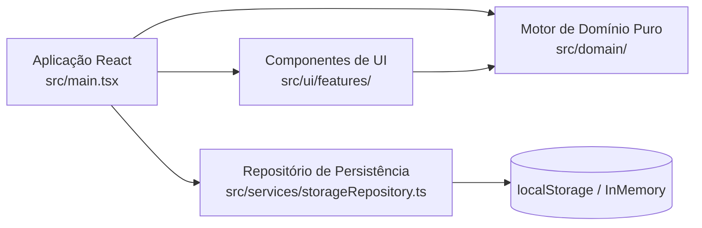
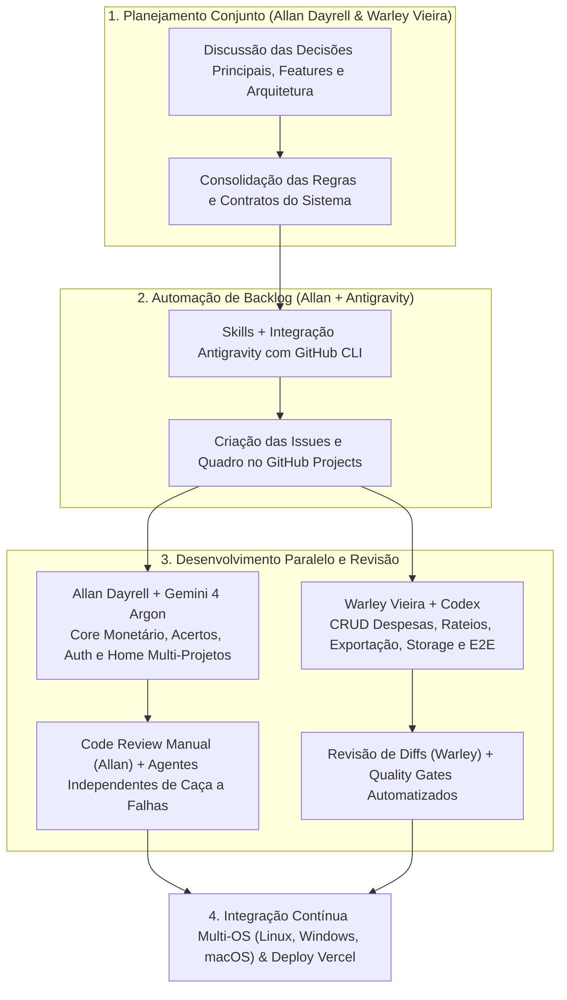

# SplitPay Ledger

[](https://github.com/allandayrell/splitpay-ledger/actions/workflows/ci.yml)
[](https://codecov.io/gh/allandayrell/splitpay-ledger)
[](https://splitpay-ledger.vercel.app/)

Aplicação web para gestão e divisão inteligente de despesas em grupo, cálculo determinístico de saldos em centavos e simplificação de transferências até a quitação total.

- **Aplicação em produção:** [https://splitpay-ledger.vercel.app/](https://splitpay-ledger.vercel.app/)

## Integrantes

- Allan Dayrell · [GitHub](https://github.com/allandayrell)
- Warley Vieira · [GitHub](https://github.com/warley004)

## Sobre o sistema

Em viagens, repúblicas e encontros, quem adianta o pagamento de uma despesa nem sempre participa do rateio na mesma proporção. O **SplitPay Ledger** organiza múltiplos projetos financeiros, calcula o saldo líquido exato de cada integrante e sugere o plano otimizado de transferências para quitar todas as dívidas com o menor número de transações.

### Funcionalidades principais

| Área | Capacidades implementadas |
| --- | --- |
| **Contas e Home Multi-Projetos** | Autenticação local com contas de demonstração e cadastro, edição de perfil com opt-in de notificações e painel inicial organizado em três seções: *Em Aberto (A Pagar ou A Receber)*, *Em Dia (Minha Parte Quite)* e *Arquivo de Projetos Fechados*, com ordenação por data de criação. |
| **Papéis e Permissões** | Separação entre *Dono do Projeto* (pode renomear, arquivar e reabrir o projeto para todos os membros) e *Participante Comum*. |
| **Participantes e Vínculo Híbrido** | Adição de participantes por nome avulso ou vinculados a uma conta registrada (disparando notificação interna e listando o projeto automaticamente na Home do usuário convidado). Permite renomear participantes preservando vínculos e bloqueia exclusão quando há despesas ou quitações associadas. |
| **Despesas e Múltiplos Pagadores** | Cadastro, edição e exclusão de despesas categorizadas, com seleção dinâmica de um ou múltiplos pagadores na mesma conta. |
| **Motor de Rateio** | Divisão entre todos os membros ou um subconjunto parcial, suportando quatro estratégias: **Igualitária (`EQUAL`)**, **Porcentagem (`PERCENTAGE`)**, **Valor Fixo Exato (`EXACT`)** e **Pesos/Cotas (`SHARES`)**. |
| **Múltiplas Moedas** | Em projetos com moeda-base `BRL`, despesas em `USD`, `EUR` ou `GBP` são convertidas por taxa de câmbio fixa informada no lançamento, preservando o valor original e a cotação registrada. |
| **Simplificação e Quitações** | Algoritmo guloso determinístico que reduz ciclos e cadeias transitivas para no máximo `N - 1` transferências. Suporta registro de pagamentos totais ou parciais e reversão de quitações pelo histórico. |
| **Filtros e Exportação** | Filtragem combinada por participante, categoria e busca textual, além de exportação em **CSV (RFC-4180)**, **Resumo em Texto** e **JSON**. |

## Arquitetura e decisões de engenharia

A aplicação executa inteiramente no navegador, mantendo separação estrita entre estado de interface e regras de negócio puras:



- **Aritmética em centavos inteiros e conservação monetária:** Todos os cálculos operam sobre inteiros (`Cents`), eliminando erros de ponto flutuante. Os centavos residuais de divisões não exatas são distribuídos de forma determinística, garantindo que a soma das cotas seja sempre idêntica ao total da despesa e que a soma dos saldos líquidos do grupo seja sempre zero.
- **Simplificação determinística de dívidas:** O motor ordena credores e devedores por magnitude de saldo com desempate lexicográfico por identificador, liquidando saldos em no máximo `N - 1` transferências.
- **Persistência resiliente:** O repositório isola o acesso ao `localStorage`, validando a integridade estrutural dos snapshots salvos e preservando os dados originais caso detecte corrupção de armazenamento.

## Tecnologias

| Camada | Tecnologias utilizadas |
| --- | --- |
| **Frontend & Build** | React 19, TypeScript 5 (modo estrito) e Vite 6. |
| **Estilização & Ícones** | Tailwind CSS v4 e Lucide Icons (`lucide-react`). |
| **Testes de Unidade & Propriedades** | Vitest, cobertura V8 (`@vitest/coverage-v8`) e `fast-check` (*Property-Based Testing*). |
| **Testes End-to-End (E2E)** | Playwright (`@playwright/test`) com Chromium headless. |
| **Qualidade Estática & CI/CD** | ESLint, `typescript-eslint`, GitHub Actions (matriz Linux, Windows e macOS) e Codecov. |
| **Deploy** | Vercel ([splitpay-ledger.vercel.app](https://splitpay-ledger.vercel.app/)). |

## Uso de IA

O desenvolvimento seguiu uma abordagem orientada por especificações (*Specification-Driven Development*). Todo o planejamento do projeto foi realizado previamente pelos dois integrantes (**Allan Dayrell e Warley Vieira**), que discutiram e definiram em conjunto as decisões principais de negócio, as funcionalidades, os invariantes financeiros e a arquitetura do sistema antes do início da codificação assistida por IA. A execução técnica foi então dividida em duas frentes complementares:

### 1. Estruturação no Antigravity, Automação via GitHub CLI e Desenvolvimento Core/Workspace (Allan Dayrell)
- **Consolidação do Planejamento e Automação com GitHub CLI (`gh`):** A partir das definições arquiteturais alinhadas entre a dupla (modelagem em centavos inteiros, distribuição determinística de restos, simplificação gulosa de dívidas, contratos congelados em `src/domain/types.ts`, sistema de contas com vínculo híbrido e permissões de dono vs. participante), Allan Dayrell estruturou as especificações no **Antigravity** e desenvolveu skills e scripts de automação para integrar o ambiente diretamente ao **GitHub CLI**. Com isso, o quadro do **GitHub Projects**, os milestones, as labels e todas as *User Stories* (Issues) foram criados e vinculados ao repositório.
- **Desenvolvimento com Gemini 4 Argon e Code Review Manual:** A implementação das histórias de fundação monetária, grupos/participantes, rateio por valor exato e pesos, simplificação de dívidas, múltiplas moedas, autenticação local, notificações e Home multi-projetos utilizou o modelo **Gemini 4 Argon**. Todo o código gerado passou por **code review manual e validação funcional feitos por Allan Dayrell**, refinando fluxos de experiência do usuário e regras de negócio (como a categorização da Home baseada diretamente no plano otimizado de transferências, reversão de quitações e centralização de pesos).
- **Agentes Independentes para Detecção de Falhas:** Além da revisão manual, foram executados agentes à parte dedicados a inspecionar o código e os componentes em busca de falhas de estado, regressões de interface e casos de borda.

### 2. Ledger de Despesas, Rateios Igualitário/Percentual, Relatórios, Persistência, CI e E2E (Warley Vieira)
- **Desenvolvimento e Auditoria com Codex:** Na frente conduzida por Warley Vieira, o **Codex** foi utilizado para implementar o CRUD completo de múltiplas despesas e cálculo de saldos (`balanceCalculator`), as estratégias de divisão igualitária parcial e percentual (`splitEngine`), o módulo de filtros e exportação CSV/Texto/JSON (`exporter`), o repositório resiliente de armazenamento (`storageRepository`), a ampliação da suíte E2E no Playwright e a configuração da matriz multi-OS no GitHub Actions.
- **Verificação e Quality Gates:** O Codex também foi empregado para reproduzir regressões, escrever testes de invariantes e validar os *quality gates* (`lint`, `typecheck`, `test:coverage`, `build` e `test:e2e`) em cada Pull Request antes da integração na `main`.



## Execução dos testes

### Pré-requisitos e instalação

Utilize **Node.js 22.x (22.13+)** e npm. Na raiz do projeto, instale as dependências exatas do lockfile e o navegador Chromium do Playwright:

```sh
npm ci
npx playwright install --only-shell chromium
```

*(No Linux, caso faltem bibliotecas gráficas do sistema, execute `npx playwright install --with-deps --only-shell chromium`).*

### Comandos de teste e verificação

```sh
# Executa toda a suíte de 135 testes de unidade
npm test

# Executa os testes de unidade e gera o relatório de cobertura V8 e LCOV (coverage/lcov.info)
npm run test:coverage

# Executa a checagem estrita de tipos do TypeScript e o linter ESLint
npm run typecheck
npm run lint

# Gera o bundle de produção em dist/
npm run build

# Executa as 16 jornadas End-to-End no navegador real com Playwright
npm run test:e2e
```

### Indicadores atuais da suíte

| Métrica | Resultado verificado nos 3 SOs |
| --- | ---: |
| **Testes de unidade aprovados** | **135** |
| **Testes End-to-End (Playwright) aprovados** | **16** |
| **Cobertura de linhas (`Lines`)** | **99,31%** |
| **Cobertura de ramificações (`Branches`)** | **95,89%** |
| **Cobertura de funções (`Functions`)** | **100,00%** |
| **Cobertura de instruções (`Statements`)** | **99,31%** |

Para iniciar o servidor de desenvolvimento local em `http://localhost:5173`:

```sh
npm run dev
```
