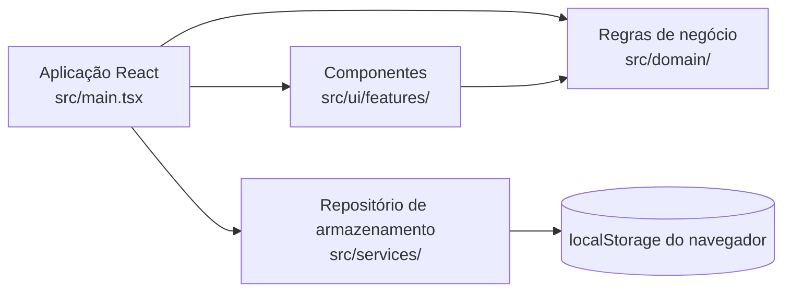
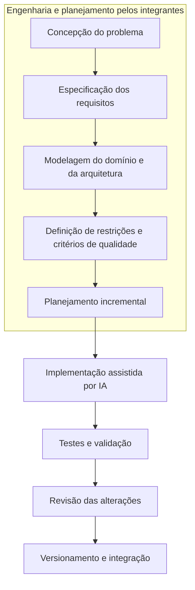

# SplitPay Ledger

[](https://github.com/allandayrell/splitpay-ledger/actions/workflows/ci.yml)

Aplicação web para registrar despesas de um grupo, calcular quanto cabe a cada pessoa e acompanhar os pagamentos até a quitação.

## Sobre o sistema

Em viagens, moradias compartilhadas e encontros, quem adianta o pagamento de uma despesa pode ser diferente de quem deve participar do rateio. O SplitPay Ledger reúne os gastos em um projeto, calcula o saldo de cada participante e sugere transferências para acertar as contas. O histórico permite consultar despesas e pagamentos à medida que os acertos são feitos.

## Funcionalidades

| Área | O que é possível fazer |
| --- | --- |
| Projetos | Criar projetos com uma moeda-base e consultar pendências na página inicial. O responsável pelo projeto pode renomeá-lo, arquivá-lo e reabri-lo. |
| Participantes | Adicionar pessoas, vincular contas locais e editar nomes. A remoção é bloqueada quando o participante está vinculado a uma despesa ou quitação registrada. |
| Despesas | Cadastrar, editar e excluir despesas com categoria e um ou mais pagadores. Cada alteração atualiza os saldos do projeto. |
| Rateio | Dividir entre todos ou selecionar um subconjunto. O rateio pode ser igualitário, percentual, por valores exatos ou por pesos. |
| Saldos e quitações | Consultar saldos e transferências sugeridas, registrar pagamentos totais ou parciais e revertê-los pelo histórico. |
| Conversão monetária | Em projetos com base BRL, registrar despesas em USD, EUR ou GBP e informar uma taxa fixa antes do rateio. O valor original e a taxa ficam registrados. |
| Filtros e exportações | Filtrar despesas por participante, categoria e descrição. Exportar a lista filtrada em CSV, um resumo do projeto em texto ou os dados do projeto em JSON. |
| Contas e persistência | Criar e acessar contas locais, editar o perfil e receber notificações internas. Os dados ficam no navegador que executa a aplicação. |

## Arquitetura e decisões de engenharia

A aplicação é executada no navegador. [`src/main.tsx`](src/main.tsx) coordena o estado do espaço de trabalho e os componentes de [`src/ui/features/`](src/ui/features/). As regras ficam em [`src/domain/`](src/domain/) e podem ser exercitadas em Node.js sem renderizar a interface. O [repositório de armazenamento](src/services/storageRepository.ts) concentra a leitura e a gravação dos dados.



- **Centavos inteiros e conservação de valores.** Os cálculos monetários usam unidades inteiras para evitar acumular frações de centavo. Uma despesa válida exige que o total pago e o total rateado coincidam com seu valor. O rateio distribui os centavos residuais por uma regra determinística, e a soma dos saldos líquidos válidos é zero. [Rateio](src/domain/split/) · [Saldos](src/domain/ledger/balanceCalculator.ts)
- **Sugestões de transferência.** O algoritmo guloso associa o maior devedor ao maior credor a cada passo e desempata pelo identificador do participante. Cada transferência zera pelo menos um saldo. Para N participantes com saldos válidos, com N ≥ 1, o plano usa no máximo N − 1 transferências. [Simplificação de dívidas](src/domain/settlement/debtSimplifier.ts)
- **Persistência local.** O repositório mantém um registro do espaço de trabalho em `localStorage`, por navegador e origem. Se um registro armazenado estiver ilegível, a aplicação exibe um aviso e preserva os dados originais. Os testes do serviço usam um adaptador em memória. [Armazenamento](src/services/storageRepository.ts) · [Inicialização do espaço de trabalho](src/main.tsx)

## Tecnologias

| Responsabilidade | Tecnologia e finalidade |
| --- | --- |
| Aplicação | React 19 e TypeScript para interface e domínio, Vite para desenvolvimento e build. |
| Estilização | Tailwind CSS para estilos e Lucide para ícones. |
| Testes unitários | Vitest para executar casos de domínio e serviços em Node.js. |
| Testes baseados em propriedades | fast-check para gerar entradas e verificar invariantes. |
| Testes de ponta a ponta | Playwright com Chromium para validar jornadas no navegador. |
| Análise estática | ESLint e typescript-eslint para lint, compilador TypeScript em modo estrito para checagem de tipos. |
| Cobertura | Vitest com provedor V8, relatórios locais e LCOV para a integração com Codecov. |
| Integração contínua | GitHub Actions para validação automatizada nos três sistemas operacionais. |
| Hospedagem | Vercel para publicação do build estático, com configuração preparada no repositório. |

## Estratégia de testes e qualidade

- **Testes unitários** exercitam APIs públicas e verificam resultados observáveis, como o saldo após uma despesa ou a rejeição de um percentual inválido. O fast-check verifica propriedades sobre entradas geradas, como a conservação de centavos e a liquidação dos saldos após aplicar as transferências sugeridas. Casos de regressão cobrem defeitos reproduzidos, entre eles a apresentação de saldos inconsistentes como quitados. [Testes de rateio](src/domain/split/splitEngine.test.ts) · [Testes de acertos](src/domain/settlement/debtSimplifier.test.ts) · [Correção da classificação de saldos](https://github.com/allandayrell/splitpay-ledger/pull/28)
- **Testes E2E** cobrem jornadas no navegador. Entre elas estão criar um projeto, registrar despesas com múltiplos pagadores, aplicar filtros, exportar relatórios, quitar e reverter pagamentos e recarregar a aplicação preservando os dados. [Suíte Playwright](e2e/workspace.spec.ts)
- **Verificações de integração** executam lint, checagem de tipos, build, testes unitários com cobertura e E2E em Linux, Windows e macOS. O projeto exige pelo menos **85% em cada métrica de cobertura** do domínio e dos serviços e tem como meta **95%** nesse escopo. O enunciado exige pelo menos 50 testes unitários, 5 E2E e 80% de cobertura. [Configuração de cobertura](vite.config.ts)

Resultados da execução de referência em `main` no commit `b6b67fb`. Os três sistemas operacionais apresentaram os mesmos resultados. [Execução no GitHub Actions](https://github.com/allandayrell/splitpay-ledger/actions/runs/45749992275)

| Indicador | Resultado por sistema operacional |
| --- | ---: |
| Testes unitários aprovados | 135 |
| Testes E2E aprovados | 16 |
| Cobertura de linhas | 99,31% |
| Cobertura de ramificações (branches) | 95,89% |
| Cobertura de funções | 100% |
| Cobertura de instruções (statements) | 99,31% |

## Uso de IA e metodologia de desenvolvimento

Antes de incorporar IA à implementação, os integrantes dedicaram horas à concepção e ao planejamento do sistema. O processo seguiu desenvolvimento orientado por especificações (*Specification-Driven Development*). As regras e os critérios definidos nessa etapa orientaram a implementação e os testes de cada incremento.

- **Integrantes.** Definiram o problema e os requisitos, modelaram o domínio e decidiram a arquitetura, os contratos e os invariantes. Também delimitaram o escopo, priorizaram as entregas, estabeleceram os critérios de aceitação e qualidade e supervisionaram o desenvolvimento.
- **Codex.** Executou grande parte da implementação técnica dentro desse escopo. Contribuiu com código e testes, investigação e reprodução de defeitos, correções incrementais, configuração da CI, documentação e execução das verificações previstas.



Os registros de decisões e o backlog preservaram o contexto entre incrementos. As mudanças foram organizadas em branches por escopo, com commits descritivos e pull requests que registram objetivos, requisitos e evidências de teste. A revisão das especificações, decisões e critérios de aceitação ficou sob responsabilidade dos integrantes. Na execução técnica, o Codex apoiou a revisão dos diffs, e os checks automatizados verificaram os critérios de integração (*quality gates*). [Correção de persistência](https://github.com/allandayrell/splitpay-ledger/pull/30) · [Registro de despesas](https://github.com/allandayrell/splitpay-ledger/pull/33) · [Conversão monetária](https://github.com/allandayrell/splitpay-ledger/pull/37)

## Execução local

Use **Node.js 22.x a partir da versão 22.13**, com npm, e Git para clonar o repositório. O comando `npm ci` usa as versões registradas no lockfile.

```sh
git clone https://github.com/allandayrell/splitpay-ledger.git
cd splitpay-ledger
npm ci
```

Inicie o servidor de desenvolvimento e abra `http://localhost:5173`. A primeira visita inicia um espaço de trabalho de demonstração.

```sh
npm run dev
```

Gere o build de produção em `dist/`. Para conferir o resultado localmente, execute `npm run preview` e abra `http://localhost:4173`.

```sh
npm run build
```

## Execução dos testes

### Testes unitários

Execute a suíte com `npm test`. Durante o desenvolvimento, use `npm run test:watch` para reexecutar os testes conforme os arquivos mudam.

### Cobertura

Execute `npm run test:coverage` para rodar os testes unitários e conferir as quatro métricas no terminal. O relatório LCOV é gravado em `coverage/lcov.info`.

### Testes E2E

Instale o Chromium e execute a suíte.

```sh
npx playwright install --only-shell chromium
npm run test:e2e
```

No Linux, se faltarem dependências de sistema, use `npx playwright install --with-deps --only-shell chromium`. O Playwright gera o build de produção e sobe o servidor em `127.0.0.1:4173`. Deixe essa porta livre ao executar a suíte. [Navegadores no Playwright](https://playwright.dev/docs/browsers)

### Verificações de qualidade

Use `npm run typecheck` para checar os tipos, `npm run lint` para executar a análise estática e `npm run build` para verificar a compilação e o empacotamento.

## Integração contínua e publicação

- **GitHub Actions em operação.** O workflow é executado em pushes, pull requests e por acionamento manual. Em Linux, Windows e macOS, roda as verificações de qualidade, os testes unitários com cobertura e os E2E. A CI disponibiliza um artefato LCOV por sistema operacional. [Workflow](.github/workflows/ci.yml)
- **Codecov preparado.** O job de publicação na `main` usa o LCOV do Linux e depende do secret `CODECOV_TOKEN`. Na execução de referência, o envio foi omitido porque o token estava indisponível. Para ativá-lo, o proprietário habilita o repositório no Codecov, cadastra o secret em **Settings → Secrets and variables → Actions** e executa o workflow **CI** na `main`. Depois, pode conferir o upload no GitHub Actions e o relatório do mesmo commit no Codecov. [Configuração do Codecov](https://docs.codecov.com/docs/codecov-tokens)
- **Vercel preparada.** A publicação da aplicação depende da ativação pelo proprietário. O arquivo de configuração define Vite, `npm ci`, `npm run build` e a saída `dist/`. Para publicar, importe o repositório na Vercel com `main` como branch de produção e Node.js 22.x. Valide na URL publicada a página inicial, a abertura de um projeto e o plano de transferências. [Configuração do projeto](vercel.json)

## Integrantes

- Allan Dayrell · [GitHub](https://github.com/allandayrell)
- Warley Vieira · [GitHub](https://github.com/warley004)
